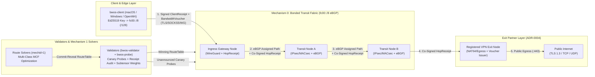
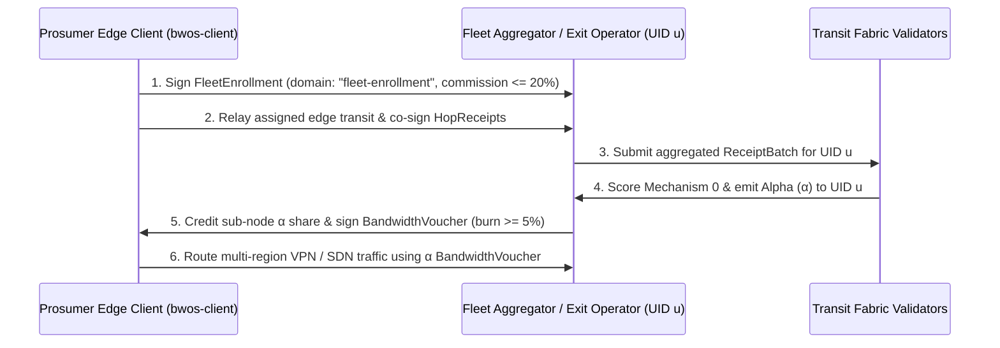
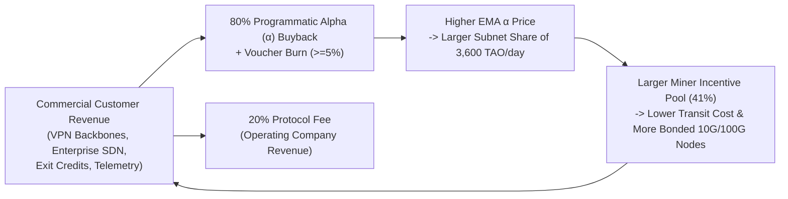

> Taken from the Transit Fabric source repository at commit 91be12e (91be12ef98b775c7f045124e6b8c686c15439650, main), file docs/whitepaper.md. Links into the private source tree are shown as plain text.

# Transit Fabric (BandwidthOS): A Cryptographically Verifiable `fc00::/8` eBGP Transit Fabric and Multi-Commodity Routing Market on Bittensor

**Version:** 1.1 (2026-11-07). Replaces 1.0.  

## What changed in version 1.1

These decisions were made on 2026-11-06 and are reflected in the sections below. Where a section still describes the older design, it says so.

1. **Unearned weight goes to a disclosed first-party UID, not a burn or recycle UID** (§4.2; `scoring.md` §Unearned weight and the first-party UID). Version 1.0 sent the reference solver's share to a burn UID. That was dropped: the usual way to burn on Bittensor is to weight the owner's own hotkey, which the chain penalises by cutting the subnet's TAO share.
   - **Routing (Mechanism 1):** unearned weight goes to a public first-party UID on a separate coldkey, and the amount is reported every window. Unearned weight means the reference solver's share, or everything when no solver scores. It shrinks as outside solvers beat the reference solver by more than `EPSILON_ROUTE` (2%).
   - **Transit (Mechanism 0):** unearned weight goes to no one. If no node has proven capacity in a window, validators set no transit weights at all.
2. **Nodes are paid only in emissions, and customer traffic is checked, never credited** (ADR-0053; §3.2, §4.1). Customers pay the company in USDC. The company converts it to TAO and buys alpha. Vouchers, payments and client receipts are commercial metering, never a scoring input, so faking or steering "paid" traffic earns nothing. Mishandling customer traffic can only lower a node's score.
3. **An always-on canary stream plus random full-rate bursts proves transit** (ADR-0051; §3.3). Validators keep a low-rate canary stream through every node, on routes they allocate, checked at each hop. Frequent random full-rate tests catch burst-rented capacity.
4. **Buyback alpha never becomes validator power** (ADR-0053, OQ-105). The company holds the alpha it buys on hotkeys that never set weights, and that stake counts for nothing in measurement.
5. **Gateways** (ADR-0052; §7). Registered datacenter operators can on-ramp customers over BGP, cross-connects or a proxy. They can off-ramp to a customer's own network, or to allowlisted public destinations, so the customer's far end needs no Transit Fabric software. Ordinary transit nodes still never egress.
6. **One System One sidecar on every node, with a public skill library learned from the fleet** (ADR-0047, ADR-0048, ADR-0050).
7. **The operating company is BandwidthOS** (Inc. or LLC, not yet decided).


**Repository:** `bandwidthOS` (`bwos-core`, `bwos-node`, `bwos-solver`, `bwos-validator`, `bwos-probe`, `bwos-client`, `bwos-sim`)

---

## Abstract

The global internet backbone suffers from two structural inefficiencies: **(1) stranded physical capacity**, where datacenter and hosting operators purchase committed 95th-percentile transit and leave 30–60% of their committed headroom idle, and **(2) performance-blind routing**, where the Border Gateway Protocol (BGP) selects paths by Autonomous System (AS) hop count and bilateral billing policy rather than real-time latency, jitter, packet loss, or link saturation. Hyperscalers (Google B4, Meta Express Backbone, Cloudflare Argo) solved these problems internally using private Software-Defined Wide Area Networks (SD-WANs) and centralized Multi-Commodity Flow (MCF) traffic-engineering solvers, but those capabilities remain locked inside proprietary corporate backbones. Meanwhile, first-generation decentralized bandwidth and VPN networks failed to capture institutional datacenter supply due to exit-node abuse liability, trivial self-dealing (wash-trading) of byte counters, and userspace cryptographic bottlenecks.

We present **Transit Fabric (BandwidthOS)**, a Bittensor subnet that turns committed datacenter and prosumer edge bandwidth into an open, cryptographically verifiable Layer-3/Layer-4 transit fabric. Every node and client in Transit Fabric derives a deterministic, unforgeable `/128` IPv6 Unique Local Address (`fc00::/8`) directly from its Ed25519 public key, forming a flat, zero-registry eBGP overlay (`ASN 4200000000+`) over kernel WireGuard, IPsec ESP (`RFC 4303`), and IEEE 802.1AE MACsec links. To align incentives without a central coordinator, Transit Fabric splits Bittensor emissions across two specialized mechanisms: **Mechanism 0 (`mechid=0`)** rewards transit operators for verified bottleneck capacity and conservation-of-flow traffic delivery, while **Mechanism 1 (`mechid=1`)** runs a continuous tournament among route solvers that compute capacity-aware, multi-class (`realtime`, `low_latency_hd`, `bulk`, `economy`, `resilient`) route tables. Transit nodes never egress to the public internet; only registered exit partners and registered gateways do (`ADR-0004`, `ADR-0052`). Nodes are paid only in emissions, from capacity proven by random full-rate tests and from carriage of a validator-allocated canary stream checked at every hop (`ADR-0051`). Customer traffic is checked, never credited (`ADR-0053`), so wash-trading earns nothing, while forwarding stays at kernel line rate. We validate the protocol through a 50-window adversarial game-theoretic simulator and live transatlantic multi-region deployments across North America and Europe.

---

## 1. Introduction & Motivation

### 1.1 The Stranded Datacenter Transit Opportunity
Institutional datacenter operators, bare-metal cloud providers, and regional colocation facilities purchase upstream IP transit on fixed monthly commitments (typically billed at the 95th percentile of 5-minute traffic samples over 10 Gbps, 40 Gbps, or 100 Gbps ports). To survive diurnal traffic peaks and DDoS bursts without incurring punitive overage rates, operators provision substantial headroom that sits idle for the majority of the billing cycle. Because the commit is already sunk, the marginal cost to an operator of carrying additional overlay transit traffic below their 95th-percentile commit is near zero.

### 1.2 The Pathology of Public Internet BGP
Even when physical fiber paths between two regions are uncongested, public internet BGP routinely selects suboptimal routes:

- **AS-Path Blindness:** Standard BGP selects routes primarily by `LOCAL_PREF` and `AS_PATH` length. A 2-hop AS path with 4% packet loss and 45 ms of queuing jitter is preferred over a 4-hop AS path with 0% loss and 12 ms lower propagation delay.
- **Slow Convergence:** Public BGP route convergence following a fiber cut or peering brownout can take tens of seconds to minutes, disrupting real-time voice, video, gaming, and distributed AI training workloads.
- **No Native Quality-of-Service (QoS) Differentiation:** Public BGP cannot simultaneously route a latency-critical flow over a low-jitter path, a bulk dataset transfer over a widest-bandwidth path, and a high-availability flow over interior-node-disjoint primary and backup paths.

Hyperscalers solved this by treating all of their datacenters as nodes in a single flat graph controlled by a traffic-engineering solver (such as Google's B4 and Cloudflare's Magic WAN). Transit Fabric brings this exact architecture to an open, permissionless market of independent operators.

### 1.3 Why First-Generation Decentralized Bandwidth Networks Failed
Prior attempts at tokenized bandwidth markets and decentralized VPNs (dVPNs) encountered three fatal failure modes:

1. **The Exit Liability Trap:** Legacy dVPNs required every bandwidth provider to act as a public internet exit node. When an anonymous user routed abusive traffic (DMCA violations, credential stuffing, or port scanning) through a node, the hosting operator received abuse complaints and risked immediate upstream BGP session termination. Consequently, institutional datacenter operators refused to participate, leaving legacy dVPNs with unreliable residential proxies.
2. **The Wash-Trading Death Spiral:** Protocols that rewarded miners proportional to "bytes relayed" without route-assignment enforcement or burn-backed demand verification were immediately gamed. Miners spun up two colluding nodes in the same datacenter rack and transmitted gigabits per second of synthetic loop traffic to capture 99% of token emissions.
3. **Userspace Mixnet Bottlenecks:** Privacy mixnets that wrap every packet in multi-layer userspace cryptography (e.g., Sphinx packet formats) incur severe CPU and serialization overhead, reducing throughput to a few megabits per second and adding hundreds of milliseconds of latency—rendering them unusable for institutional transit or daily desktop networking.

Transit Fabric resolves all three failure modes at the protocol layer:

- **Strict Transit vs. Exit Separation (`ADR-0004`):** Mechanism 0 transit nodes **never** egress packets to the public internet; they only forward encrypted `fc00::/8`-to-`fc00::/8` overlay traffic between bound peers. Public internet egress is performed only by registered **Exit Partners** (crypto-accepting VPN providers) and **registered gateways** (datacenter operators that meet published criteria, carrying paid, allowlisted traffic only, `ADR-0052`).
- **Solver-Assigned Routes + Conservation-of-Flow Receipts:** Miners cannot choose their own traffic paths. Transit is only rewarded on paths assigned by the winning Mechanism 1 route table (or unannounced Validator Canary Probes), verified by adjacent co-signed `HopReceipts` and per-hop digests. Since version 1.1, nodes are paid only in emissions, and customer traffic is never credited (`ADR-0053`), so synthetic loop traffic earns nothing.
- **Cryptographic Control Plane, Kernel Data Plane:** Cryptography is used to derive `/128` IPv6 identities, authenticate route tables, and co-sign periodic byte-counter receipts, while packet forwarding runs at line rate in the OS kernel (`WireGuard`, `IPsec ESP`, `MACsec`, and `FQ/BBR`).

---

## 2. System Architecture & Cryptographic Identity



### 2.1 Separation of Network Identity and Economic Identity
Transit Fabric enforces a strict cryptographic boundary between a machine's **network identity** and an operator's **economic identity** (`docs/specs/identity.md`):

| Key Type | Algorithm | Storage Location | Protocol Role |
| :--- | :--- | :--- | :--- |
| **Node Key** | `Ed25519` (RFC 8032) | Node / Appliance (`~/.bwos/node.key`, `0600`) | Network identity; derives `fc00::/8` IPv6 address; signs `HopReceipts` and `WgBindings` |
| **WireGuard Key** | `X25519` (RFC 7748) | Node / Client (`~/.bwos/wg.key`, `0600`) | Ephemeral/rotatable tunnel transport key bound via signed `WgBinding` |
| **Operator Hotkey** | `sr25519` (Subtensor) | Off-box Operator Wallet | Economic identity (UID); signs `NodeBindings` and `CapacityDeclarations` |
| **Client Key** | `Ed25519` (RFC 8032) | End-user device (`~/.bwos/client.key`, `0600`) | Derives client `fc00::/8` address; signs `ClientReceipts` and `FleetEnrollments` |

Appliances and transit servers **never hold a Bittensor hotkey**. An operator links a fleet of nodes to their Bittensor UID by publishing a hotkey-signed `NodeBinding` (domain `node-binding`), whose SHA-256 digest is committed on-chain and served via content-addressed HTTP (`/v0/objects/node-binding/<sha256>`, `ADR-0015`). If any node public key appears in two live `NodeBindings` from different hotkeys, validators deterministically exclude the conflicting node from both fleets.

### 2.2 Zero-Registry Cryptographic IPv6 Addressing (`fc00::/8`)
On the public internet, participating in BGP requires acquiring an Autonomous System Number (ASN) and IP prefix from a Regional Internet Registry (ARIN, RIPE, APNIC) and maintaining RPKI Route Origin Authorizations (ROAs).

In Transit Fabric, every node and client deterministically derives a unique `/128` IPv6 address inside the RFC 4193 Unique Local Address (`fc00::/8`) space directly from its 32-byte Ed25519 public key $\text{pk}$:

$$\text{digest} = \text{SHA-512}\!\left(\text{SHA-512}(\text{pk})\right)$$

$$\text{addr}_{128} = \texttt{0xfc} \;\|\; \text{digest}[0..15]$$

This construction provides three critical properties:

1. **Zero Key Grinding:** Unlike CJDNS (which requires brute-force CPU grinding until a double-SHA-512 hash begins with `0xfc`), Transit Fabric prepends the `0xfc` ULA prefix byte to the first 15 bytes (120 bits) of the double-SHA-512 digest. Key generation takes less than 50 microseconds on any CPU while providing $2^{120}$ collision resistance.
2. **Impossible BGP Prefix Hijacking:** Because the `/128` IPv6 address is a one-way cryptographic function of $\text{pk}$, no node on the overlay can originate or spoof a route for `fcxx:...` without possessing the corresponding Ed25519 private key.
3. **Universal Peer Parity:** Every participant—whether a 100 Gbps core router in Frankfurt, a cloud VM in Illinois, or a macOS laptop on Wi-Fi—speaks the exact same `fc00::/8` addressing scheme.

### 2.3 Flattened eBGP Control Plane and Kernel Data Plane
Rather than inventing a custom userspace packet-routing daemon, Transit Fabric treats every node as a first-class datacenter router running standard **FRRouting (`bgpd` + `bfdd`)** over point-to-point encrypted links:

- **Deterministic 4-Byte Private ASN Derivation:** Each node derives an RFC 6996 4-byte private ASN from its public key (`OVERLAY_BASE_ASN = 4,200,000,000` + deterministic node offset), originating its `/128` `fc00::/8` loopbacks into eBGP.
- **Sub-Second BFD Failover:** Bidirectional Forwarding Detection (`bfdd` on kernel nodes, `bwos_net::bfd` on no-root nodes, `3 × 200 ms` intervals, so 600 ms detection) monitors every adjacent peer link. If a primary link drops, the BGP session ends and traffic moves to the solver-precomputed `backup_path`: measured at 544-716 ms in namespaces and an outage of 520-680 ms over the internet (`docs/results/phase-a-spikes.md`), without waiting for global control-plane reconvergence.
- **Transport Encryption & Host Kernel Tuning:**
  - **Edge & VMs:** Kernel WireGuard (`ChaCha20-Poly1305`) with key-rotated `WgBindings`.
  - **Datacenter Backbone:** Point-to-point **IPsec ESP (`RFC 4303`, AES-256-GCM)** or Layer-2 **IEEE 802.1AE MACsec (`GCM-AES-128/256`)** with deterministic pairwise key derivation (`ipsec-ike-psk`, `ipsec-esp-key`, `macsec-cak`, `macsec-ckn`) for hardware NIC crypto offload (`mlx5` / Intel QAT).
  - **Host TCP/UDP Offload Profile (`bwos-node tune-host`):** Configures Linux `fq` pacing + `BBR` congestion control, 64 MB socket buffers (`net.core.rmem_max = 67108864`), and `ethtool` UDP GRO forwarding (`rx-udp-gro-forwarding on`).

---

## 3. Cryptographic Accounting & Conservation of Flow

A decentralized transit market is only as strong as its resistance to fabricated traffic. Transit Fabric enforces **conservation of flow** across every multi-hop path using four cryptographic primitives serialized in strict canonical JSON (`docs/specs/encoding.md`: lexicographically sorted UTF-8 keys, no whitespace, integer-only numbers, and domain-separated signatures over `"BWOS-v0/" || domain || "\0" || canonical_bytes`).

### 3.1 Adjacent Co-Signed `HopReceipts`
Every `RECEIPT_INTERVAL` (`30 s`), each pair of adjacent nodes $(u, d)$ on an active path exchanges and co-signs cumulative byte counters for the current window $w$ across three accounting classes (`paid`, `free`, `canary`):

```json
{
  "v": 0,
  "window": 1234,
  "seq": 17,
  "up": "<upstream_node_pubkey_hex>",
  "down": "<downstream_node_pubkey_hex>",
  "bytes": { "paid": 123456789, "free": 0, "canary": 4567890 },
  "sig_up": "<ed25519_hex>",
  "sig_down": "<ed25519_hex>"
}
```

1. **Monotonicity:** Within a window $w$, byte counters for each class MUST be monotonically non-decreasing with sequence number `seq`.
2. **Bilateral Tolerance Gate:** Upstream node $u$ proposes its cumulative transmitted bytes and signs `sig_up` (domain `hop-receipt`). Downstream node $d$ compares $u$'s proposed counts against its own received byte counters. If the discrepancy is within `RECEIPT_TOLERANCE_PPM` ($5{,}000\text{ ppm} = 0.5\%$), $d$ appends `sig_down`. Otherwise, $d$ counter-proposes its own lower counts. Unilateral (single-signed) receipts earn zero credit.
3. **Multi-Hop Chain Conservation Check:** Given an assigned route $n_0 \to n_1 \to n_2 \to \dots \to n_k$, validators verify the chain of highest-`seq` co-signed receipts $(n_0, n_1), (n_1, n_2), \dots, (n_{k-1}, n_k)$:
   - If any interior hop $n_i$'s reported bytes exceed both its upstream receipt $(n_{i-1}, n_i)$ and downstream receipt $(n_i, n_{i+1})$ by more than `RECEIPT_TOLERANCE_PPM`, hop $n_i$ is flagged for inflation and its credit on that path is **zeroed**.
   - If any interior receipt $(n_{i-1}, n_i)$ is missing, the entire multi-hop chain is **zeroed** for that window segment.
   - Across diamond or DAG topologies where multiple routes traverse a shared bottleneck link $(n_a, n_b)$, validators aggregate flow conservation across the union of assigned routes so legitimate shared hops are never falsely penalized (`crates/bwos-core/src/validator.rs`).

### 3.2 Boundary Attestation: `ClientReceipts` and `BandwidthVouchers`

> **Superseded for scoring by ADR-0053 (version 1.1).** Client receipts and vouchers remain commercial metering: quota, billing, and destination allowlists for gateways. They are never a scoring input. A colluding path gains nothing by co-signing fake `paid` bytes, because paid bytes earn no emissions. The 1.0 text below describes the retired design and is kept for reference. Its code paths are removed in roadmap PB-40.

While `HopReceipts` prevent interior nodes from inflating counters relative to their neighbors, what stops an entire colluding path $n_0 \to n_1 \to n_2$ from co-signing fake `paid` bytes?

Transit Fabric closes this boundary loop with two end-to-end mechanisms (`ADR-0016`, `ADR-0019`):

1. **Client Receipts (`client-receipt`):** The end-user client (`bwos-client`) signs cumulative delivery receipts binding `(window, client, ingress, egress, bytes)`. Validators verify that `paid` bytes claimed at the ingress hop $(n_0, n_1)$ are covered by valid `ClientReceipts` within `RECEIPT_TOLERANCE_PPM`. Any uncovered `paid` bytes are automatically downgraded to `free` (`W_FREE = 250,000` ppm vs. `W_PAID = 1,000,000` ppm).
2. **Burn-Backed Bandwidth Vouchers (`bandwidth-voucher`):** To qualify as `paid` traffic (`W_PAID`), a session must be authorized by a `BandwidthVoucher` signed by a registered Exit Partner or Fleet Aggregator:
   - Issuing a `BandwidthVoucher` requires a mandatory minimum protocol burn/fee of `PROTOCOL_VOUCHER_BURN_PPM` ($50{,}000\text{ ppm} = 5\%$, with $10\%$ default in simulation).
   - Because any miner attempting to mint vouchers to wash-trade their own transit nodes forfeits the protocol burn upfront and must share Mechanism 0 emissions with all honest capacity and usage on the subnet, self-dealing is strictly negative-EV.

### 3.3 Unannounced Canary Probes & Random Saturation Capacity Tests

> **Updated in version 1.1 (ADR-0051, ADR-0053):**
> - **An always-on canary stream.** Validators keep a low-rate canary stream through every node, on node pairs they allocate by a verifiable draw. The production table supplies only the hops.
> - **Secret schedules.** Each validator's schedule is secret until the window ends: it is committed before the window and revealed after.
> - **Checked at every hop.** Only bytes that reach the validator's sink and pass per-hop digests count.
> - **Shaped like real traffic.** Canaries follow global traffic statistics and include full-rate flows, so throttling shows up as well as dropping.
> - **Frequent random full-rate tests.** About 20 a day per node on testnet (`CAP_TEST_PERIOD` 360 blocks, Task 15b), so capacity rented only for test bursts shows up on the renter's bill.
> - **Team tests.** The full-rate tests run 60 s and are pushed by a team of validators (ADR-0039).
>
> Specified in Task 14 and PB-38. The 1.0 text below describes the earlier shared, computable schedule.

Validators run `bwos-probe` daemons from distributed vantage points using a shared, deterministic probe schedule seeded by the Subtensor block hash (`docs/specs/measurement.md`):

- **Indistinguishable Canary Flows:** Validator canary probes are padded and encapsulated to look identical to `paid` customer traffic on the wire. Transit nodes cannot selectively prioritize probes over customer traffic.
- **Random Saturation Capacity Tests:** Every `CAP_TEST_PERIOD` (`900 blocks`), validators select nodes pseudorandomly for a `CAP_TEST_SECONDS` (`10 s`) saturation burst to measure actual deliverable throughput $B_{\text{meas}}(n)$ against declared capacity $B_{\text{decl}}(n)$:
  - If $B_{\text{meas}}(n) \ge B_{\text{decl}}(n) \cdot (1 - \text{CAP\_TOLERANCE\_PPM}/10^6)$ (within 10% tolerance), the node receives full credit for its declared capacity: $B_{\text{ver}}(n) = B_{\text{decl}}(n)$.
  - If a node over-claims its physical capacity ($B_{\text{meas}}(n) < 0.90 \cdot B_{\text{decl}}(n)$), it suffers an immediate `OVERCLAIM_PENALTY_PPM` ($200{,}000\text{ ppm} = 20\%$) haircut below its measured throughput:
    $$B_{\text{ver}}(n) = B_{\text{meas}}(n) \cdot \frac{10^6 - \text{OVERCLAIM\_PENALTY\_PPM}}{10^6}$$
    This penalty persists for `CAP_PENALTY_WINDOWS` (`24 windows`), and capacity declarations are subject to a `CAP_CHANGE_WINDOWS` (`24 windows`) cooldown.

---

## 4. Dual-Mechanism Incentive Design

All scoring in Transit Fabric (`crates/bwos-core/src/scoring/mod.rs`) is implemented in **100% deterministic integer fixed-point arithmetic** (`u128`/`i128` parts-per-million, $10^6\text{ ppm} = 1.0$, with floor division and deterministic `BTreeMap` UID ordering). Given identical committed inputs, every honest validator on any CPU architecture computes **byte-identical Subtensor weight vectors**.

### 4.1 Mechanism 0 (`mechid=0`): Physical Transit Capacity & Verified Usage

For each transit operator UID $u$ in window $w$:

1. **Verified Fleet Capacity ($K_u$) and Uptime-Weighted Capacity ($\text{cap}_u$):**
   $$K_u = \sum_{n \in \text{Fleet}(u)} B_{\text{ver}}(n), \qquad \text{cap}_u = \left\lfloor \frac{K_u \cdot A_u^k}{(10^6)^k} \right\rfloor$$
   where $A_u \in [0, 10^6]$ is the operator's probe availability (uptime in ppm) and $k = \text{UPTIME\_EXP} = 2$. Squaring uptime strongly penalizes flaky nodes ($50\%$ uptime yields $25\%$ capacity credit).

2. **Node Delivery Quality ($Q_n$):**
   $$\text{lat\_ppm}_n = \min\!\left(10^6,\; \left\lfloor \frac{\text{predicted\_us}_n \cdot 10^6}{\text{measured\_us}_n} \right\rfloor\right)$$
   $$\text{loss\_ppm}_n = 10^6 - \min\!\left(10^6,\; \text{loss\_measured\_ppm}_n \cdot \text{LOSS\_MULT}\right)$$
   $$Q_n = \left\lfloor \frac{\text{lat\_ppm}_n \cdot \text{loss\_ppm}_n}{10^6} \right\rfloor$$
   Crucially, $\text{predicted\_us}_n$ is computed deterministically by validators from the window's topology snapshot link latencies (`routing::route_predicted_us`), never trusted from an unverified solver estimate. With $\text{LOSS\_MULT} = 10$, a node with $\ge 10\%$ packet loss receives $Q_n = 0$.

> **Updated in version 1.1 (ADR-0053):** the usage term $\text{use}_u$ becomes **verified canary carriage only**: validator-allocated, delivered, digest-passing bytes. Paid and free customer bytes never enter it. Until PB-38 lands, Mechanism 0 pays on capacity alone ($W = 10^6$), and the paid-traffic trigger described in 1.0 is retired (PB-40). Steps 3 and 5 below describe the 1.0 design.

3. **Quality-Adjusted Verified Usage ($\text{use}_u$):**
   $$\text{use}_u = \sum_{n \in \text{Fleet}(u)} \sum_{c \in \{\text{paid}, \text{free}, \text{canary}\}} \left\lfloor \frac{\text{bytes}_{\text{ver}}(n, c) \cdot W_c \cdot Q_n \cdot C_n}{10^{18}} \right\rfloor$$
   where class weights are $W_{\text{paid}} = 1{,}000{,}000\text{ ppm}$, $W_{\text{free}} = 250{,}000\text{ ppm}$, and $W_{\text{canary}} = 100{,}000\text{ ppm}$, and $C_n \in [10^6, C_{\max}]$ is the geographic/ASN diversity multiplier.

4. **Usage Concentration Cap (`USAGE_SHARE_CAP`):**
   To prevent a single large operator from monopolizing usage emissions, no UID's usage share $\text{use}_u / \sum \text{use}$ may exceed `USAGE_SHARE_CAP` ($250{,}000\text{ ppm} = 25\%$) whenever at least $\lceil 10^6 / \text{USAGE\_SHARE\_CAP} \rceil = 4$ UIDs have positive usage. Excess share is iteratively clipped and redistributed pro rata across uncapped UIDs.

5. **Blended Mechanism 0 Share ($\text{share}_u$):**
   $$\text{share}_u = \left\lfloor \frac{\text{ALPHA} \cdot \text{cap}_u}{\sum_j \text{cap}_j} \right\rfloor + \left\lfloor \frac{(10^6 - \text{ALPHA}) \cdot \widehat{\text{use}}_u}{\sum_j \widehat{\text{use}}_j} \right\rfloor$$
   At network bootstrap, $\text{ALPHA} = 700{,}000\text{ ppm}$ ($70\%$ bonded capacity, $30\%$ verified traffic usage) to guarantee reliable baseline capacity for launch partners, stepping down via governance as paid traffic volume scales.

---

### 4.2 Mechanism 1 (`mechid=1`): Competitive Multi-Commodity Route Solving

In Mechanism 1, route solvers compete every window via commit-reveal (`hash("route-table", table)`) to optimize the global route table across five distinct QoS traffic classes (`ADR-0017`, `ADR-0018`):

| Traffic Class | Target Use Case | Composite Objective Weights | Hard SLA Gate |
| :--- | :--- | :--- | :--- |
| **`realtime`** | VoIP, trading, gaming, interactive SSH | $70\%\ G_{\text{lat}} + 30\%\ G_{\text{jit}}$ | $\text{RTT} \le \text{direct}$, $\text{jitter} \le 5\text{ ms}$, $\text{loss} \le 0.5\%$ |
| **`low_latency_hd`** | 4K video conferencing, cloud desktop | $50\%\ G_{\text{lat}} + 50\%\ G_{\text{bw}}$ | $\text{RTT} \le \text{direct}$, $\text{loss} \le 5.0\%$ |
| **`bulk`** | AI checkpoint sync, dataset replication | $80\%\ G_{\text{bw}} + 20\%\ G_{\text{lat}}$ | $\text{RTT} \le 1.50 \times \text{direct}$, $\text{loss} \le 5.0\%$ |
| **`economy`** | Background backups, low-cost transit | $70\%\ G_{\text{cost}} + 30\%\ G_{\text{lat}}$ | $\text{RTT} \le 1.50 \times \text{direct}$, $\text{loss} \le 5.0\%$ |
| **`resilient`** | Mission-critical dual-path HA links | $60\%\ G_{\text{lat}} + 40\%\ (\mu_{\text{disj}} \cdot G_{\text{backup}})$ | Valid disjoint `backup_path`, $\text{loss} \le 5.0\%$ |

For each sampled demand pair $p = (\text{src}, \text{dst}, \text{class})$, validators evaluate the normalized improvement components clamped to $[-10^6, +10^6]\text{ ppm}$ relative to the measured direct internet baseline:

- **Latency Gain ($G_{\text{lat}}$):** $(\text{direct\_us} - \text{measured\_us}) \cdot 10^6 / \text{direct\_us}$
- **Jitter Gain ($G_{\text{jit}}$):** $(\text{direct\_jitter\_us} - \text{measured\_jitter\_us}) \cdot 10^6 / \text{direct\_jitter\_us}$
- **Loss-Adjusted Bottleneck Bandwidth Gain ($G_{\text{bw}}$):** $(\text{eff\_bottleneck\_mbps} - \text{direct\_mbps}) \cdot 10^6 / \text{direct\_mbps}$
- **Congestion-Adjusted Cost Gain ($G_{\text{cost}}$):** Each link $e$ with utilization $u_e \in [0, 10^6]\text{ ppm}$ incurs a quadratic congestion surcharge:
  $$\text{eff\_cost\_ppm}(e) = \text{cost\_ppm}(e) \cdot \left(10^6 + \left\lfloor \frac{\text{CONGESTION\_SURCHARGE\_PPM} \cdot u_e^2}{10^{12}} \right\rfloor\right) \Big/ 10^6$$
  encouraging solvers to spill traffic smoothly across parallel paths before any single bottleneck saturates.

- **Disjoint Backup Multiplier ($\mu_{\text{disj}}$):** For `resilient` routes, $\mu_{\text{disj}} = 1{,}000{,}000\text{ ppm}$ ($1.0\times$) if `backup_path` shares **neither** interior nodes nor directed links with `path`, and $500{,}000\text{ ppm}$ ($0.5\times$) if it is link-disjoint but shares an interior node.

#### Solver Score & Anti-Copycat Tournament Selection
A solver $s$'s overall window score is computed using the **lower median** of pairwise gains minus feasibility and route-flapping penalties:

$$\text{score}_s = \text{lower\_median}_{p}\!\left(\text{gain}_p(s)\right) - \text{FEASIBILITY\_PENALTY} \cdot \text{overloaded\_nodes}(s) - \left\lfloor \frac{\text{CHURN\_PENALTY} \cdot \text{churn\_ppm}(s)}{10^6} \right\rfloor$$

- **Copycat Exclusion (updated in 1.1):** only solvers that beat the reference solver by more than `EPSILON_ROUTE` earn a rung, and everything at or below the reference is unearned. A copy of last window's production table scores 0. In the 1.0 rule, any non-reference solver whose score is within `EPSILON_ROUTE` ($20{,}000\text{ ppm} = 2\%$) of the open-source reference solver (`bwos-solver`), or whose pairwise gain vector duplicates the reference solver or an earlier-committed solver, is eliminated.
- **Winner & Unearned Allocation:** The highest-scoring solver replaces the incumbent only if $\text{score}_{\text{candidate}} \ge \text{score}_{\text{incumbent}} + \text{EPSILON\_ROUTE}$. Every table is graded against the next window's snapshot, and solvers are paid on a graded ladder: the top `LADDER_N` (8) positive scores take rungs whose weights halve (`LADDER_DECAY_PPM` $= 500{,}000$), and a table within `CLONE_DISTANCE_PPM` (2%) of one committed in the same block or earlier scores 0 (`scoring.md` §Mechanism 1, ADR-0035). Any share won by the reference solver is unearned weight: it goes to the owner's disclosed **first-party UID** under a separate coldkey, never to an owner-coldkey hotkey or a burn UID, and is reported publicly (`scoring.md` §Unearned weight and the first-party UID). Unearned **transit** weight (Mechanism 0) goes to no one: with no proven capacity in a window, validators set no Mechanism 0 weights.

---

## 5. Prosumer Edge Fleet Aggregation & The "Mine-to-Surf" Loop (`ADR-0019`)

> **Version 1.1 note:** this is a later consumer feature (VPN exits, Stage 5). The vouchers it describes are commercial only and never earn emissions (ADR-0053).

Because Bittensor subnets have a fixed number of registered UID slots (e.g., 256 UIDs), individual desktop and home-lab power users cannot each register an on-chain UID. Transit Fabric solves this by introducing **Fleet Aggregators** and the **Mine-to-Surf Circular Economy**:



1. **Permissionless Sub-Node Enrollment (`FleetEnrollment`):** Any macOS, Windows, Linux, or OpenWrt device running `bwos-client` or `bwos-node` can enroll in a Fleet Aggregator UID by signing a `FleetEnrollment` object with its Ed25519 key (specifying `commission_ppm <= MAX_AGGREGATOR_COMMISSION_PPM = 200,000` ppm).
2. **Proportional $\alpha$ Accounting:** Validators score the aggregator's total verified bytes across all enrolled sub-nodes. The aggregator deducts its capped commission ($\le 20\%$) and allocates the remaining $\alpha$ pool deterministically in proportion to each sub-node's co-signed `HopReceipt` byte contribution.
3. **Mine-to-Surf Voucher Minting:** Instead of requiring credit cards or KYC, an edge user converts their earned $\alpha$ balance directly into a cryptographically signed `BandwidthVoucher` (`domain: "bandwidth-voucher"`) that authorizes high-priority `paid` VPN exit and SDN transit across the global Transit Fabric mesh.

---

## 6. Tokenomics, Alpha Buyback Flywheel & 3-Year Financial Projections

### 6.1 The Dynamic TAO ($\alpha$) Buyback Flywheel

> **Version 1.1 note:** the company converts customer USDC to TAO and buys alpha on the Transit Fabric subnet. It holds that alpha on hotkeys that never set weights, and that stake counts for nothing in measurement (ADR-0053, OQ-105). The voucher burn in the diagram below is retired: vouchers are commercial only.
Under Bittensor's Dynamic TAO (dTAO) emission model, each subnet's share of daily network emissions (`3,600 TAO/day`, or `~$366.6M/year` at `$279/TAO`) is determined by the Exponential Moving Average (EMA) price of its subnet token ($\alpha$). Within the subnet, emissions are distributed **`41%` to Miners** (Mechanism 0 transit operators and Mechanism 1 route solvers), **`41%` to Validators**, and **`18%` to the Subnet Owner**.

Rather than relying on speculative token demand alone, Transit Fabric couples commercial transit revenue directly to the $\alpha$ token via a programmatic buyback flywheel (`docs/economics/PIPE_subnet_economic_model.xlsx`):



1. **80% Programmatic $\alpha$ Buyback / 20% Protocol Fee:** Customers (VPN partners, enterprises linking multi-cloud clusters, and telemetry buyers) pay in stablecoins, fiat, or $\alpha$. **`80%` of gross external revenue** is used programmatically to buy back $\alpha$ from the subnet liquidity pool, while **`20%`** is retained by the operating company to fund core engineering, hardware appliance certification, and business development.
2. **Bootstrap-to-Usage Transition ($\alpha$ Parameter Step-Down):**
   - In **Year 1**, Mechanism 0 sets `ALPHA = 700,000` ppm ($70\%$ capacity / $30\%$ usage). At `100 Gbps` bonded capacity in the Base case, emissions pay operators **`$0.53 / Mbps / month`**—**`3.51x` the benchmark `$0.15 / Mbps / month` hub transit rate**—creating a powerful supply-side magnet for datacenter operators with idle 95th-percentile headroom.
   - In **Years 2 and 3**, as commercial traffic scales, `ALPHA` steps down (`70% -> 50% -> 40%` in Base; `60% -> 40% -> 30%` in Bull), shifting miner rewards from passive capacity standby to active, receipt-verified paid throughput.
3. **Compressing the Emission Subsidy Ratio:** Across the broader Bittensor network, subnets typically require `$22–$40` of token emissions per `$1` of external customer revenue. Because bandwidth transit is an existing multi-billion-dollar institutional market, Transit Fabric compresses its **Subsidy Ratio (Annual Emissions $\div$ Annual Customer Revenue)** from `7.01x` in Year 1 to **`1.17x` in Year 3 (Base)** and **`0.69x` in Year 3 (Bull)**—where external customer revenue exceeds total network emissions paid to the subnet.

### 6.2 Four Commercial Revenue Streams (`Bear / Base / Bull` Model)
The economic model (`docs/economics/PIPE_subnet_economic_model.xlsx`, benchmarked at `TAO = $279`, `884 TAO` registration cost = `$246,636`) projects four distinct revenue lines over Years 1–3:

| Revenue Stream | Buyer Profile | Base Case (Y1 $\to$ Y2 $\to$ Y3) | Bull Case (Y1 $\to$ Y2 $\to$ Y3) |
| :--- | :--- | :---: | :---: |
| **1. VPN Partner Backbone Transit** | Crypto-accepting VPN providers (`2 -> 5 -> 10` in Base; `3 -> 10 -> 25` in Bull) | `$192k` $\to$ `$720k` $\to$ **`$1.80M`** | `$540k` $\to$ `$3.00M` $\to$ **`$12.00M`** |
| **2. Enterprise & AI Cluster SDN** | Multi-site / GPU cluster transit (`2 -> 10 -> 30` in Base; `5 -> 30 -> 100` in Bull) | `$72k` $\to$ `$480k` $\to$ **`$1.80M`** | `$300k` $\to$ `$2.16M` $\to$ **`$9.60M`** |
| **3. Pay-Per-GB Exit Credits** | Prosumers & power users buying `BandwidthVouchers` (launches Phase 2 / Y2) | `$0` $\to$ `$150k` $\to$ **`$600k`** | `$0` $\to$ `$750k` $\to$ **`$3.00M`** |
| **4. Global Link-Metric Telemetry** | Latency/jitter/loss matrix sold to WAN monitoring & trading desks | `$50k` $\to$ `$200k` $\to$ **`$500k`** | `$100k` $\to$ `$750k` $\to$ **`$2.00M`** |
| **Total Annual Customer Revenue** | **All 4 Commercial Lines** | **`$314k` $\to$ `$1.55M` $\to$ `$4.70M`** | **`$940k` $\to$ `$6.66M` $\to$ `$26.60M`** |
| **Annual Programmatic $\alpha$ Buyback ($80\%$)** | **Direct Market Buy Pressure on $\alpha$** | **`$251k` $\to$ `$1.24M` $\to$ `$3.76M`** | **`$752k` $\to$ `$5.33M` $\to$ `$21.28M`** |

### 6.3 Three-Year Subnet & Operating Company Financial Projections

Valuation is modeled as the **Blended Average** of two institutional methodologies:

1. **Emissions Comparable Multiple:** Subnet annual incentive budget $\times$ comparable Bittensor dTAO market-cap-to-emissions multiples (`2.13x` Bear based on Chutes SN64; `2.69x` Base network average; `3.24x` Bull all-subnet multiple).
2. **Infrastructure Revenue Multiple:** Annual commercial revenue $\times$ infrastructure multiple (`10x` Bear, `15x` Base, `20x` Bull).

| Metric | Bear (Y1 / Y2 / Y3) | Base (Y1 / Y2 / Y3) | Bull (Y1 / Y2 / Y3) |
| :--- | :---: | :---: | :---: |
| **Network Emission Share** | `0.20%` / `0.30%` / `0.40%` | `0.60%` / `1.00%` / `1.50%` | `1.50%` / `3.00%` / `5.00%` |
| **Bonded Transit Capacity** | `20` / `40` / `60 Gbps` | `100` / `300` / **`800 Gbps`** | `300` / `1,500` / **`5,000 Gbps`** |
| **Subnet Incentive Budget (`$/yr`)** | `$0.73M` / `$1.10M` / `$1.47M` | `$2.20M` / `$3.67M` / **`$5.50M`** | `$5.50M` / `$11.00M` / **`$18.33M`** |
| **Miner Capacity Pay (`$/Mbps/mo`)** | `$1.00` / `$0.66` / `$0.50` | `$0.53` (`3.5x`) / `$0.21` / `$0.09` | `$0.38` (`2.5x`) / `$0.10` / `$0.04` |
| **Total Commercial Revenue (`$/yr`)** | `$36k` / `$169k` / `$375k` | `$314k` / `$1.55M` / **`$4.70M`** | `$940k` / `$6.66M` / **`$26.60M`** |
| **Programmatic $\alpha$ Buyback (`$/yr`)** | `$28.8k` / `$135.2k` / `$300k` | `$251.2k` / `$1.24M` / **`$3.76M`** | `$752k` / `$5.33M` / **`$21.28M`** |
| **Subsidy Ratio (Emissions / `$1` Rev)** | `20.37x` / `6.51x` / `3.91x` | `7.01x` / `2.37x` / **`1.17x`** | `5.85x` / `1.65x` / **`0.69x`** |
| **Subnet Market Cap — Blended (`$`)** | `$0.96M` / `$2.02M` / **`$3.44M`** | `$5.31M` / `$16.55M` / **`$42.64M`** | `$18.31M` / `$84.42M` / **`$295.70M`** |
| **Registration Payback Period** | `22.4 months` (Y1) | **`7.5 months` (Y1)** | **`3.0 months` (Y1)** |
| **Operating Co. Gross Income (`$/mo`)** | `$17.2k` / `$25.9k` / `$34.5k` | `$51.8k` / `$90.9k` / **`$166.5k`** | `$114.4k` / `$270.9k` / **`$678.6k`** |
| **Operating Co. Net Income (`$/mo`)** | `-$22.8k` / `-$24.1k` / `-$25.5k` | `-$8.2k` / `-$9.1k` / **`+$16.5k`** | `+$34.4k` / `+$90.9k` / **`+$328.6k`** |
| **Operating Co. Valuation (Treasury + OpCo)** | `$0.13M` / `$0.27M` / **`$0.47M`** | `$0.49M` / `$1.52M` / **`$5.91M`** | `$6.20M` / `$18.81M` / **`$67.32M`** |

---

## 7. Commercial Entity ("BandwidthOS Inc."), Anchor Core Routers & Go-To-Market Workflows

### 7.1 Market Positioning: Programmable NaaS & Middle-Mile SD-WAN Clearinghouse
While the Transit Fabric Bittensor subnet provides the decentralized incentive, measurement, and settlement layer, enterprise buyers, AI cloud operators, and commercial VPN providers require a standard commercial counterparty. **BandwidthOS Inc.** (the operating company in front of the subnet) operates as a **Programmable Network-as-a-Service (NaaS) and Middle-Mile SD-WAN Clearinghouse**—occupying the market intersection of **Megaport / PacketFabric** (elastic inter-datacenter transit) and **Cloudflare Magic WAN / Argo** (real-time latency/jitter-optimized routing), backed by tokenized physical supply.

BandwidthOS Inc. sells two core commercial products and two high-margin network by-products:

1. **Aggregated Transit on Demand (Elastic Middle-Mile):** Customers establish a single eBGP/IPsec/WireGuard session (or rack a zero-touch 1U `Transit Fabric Edge` appliance) into the nearest Transit Fabric hub and gain instant burst transit across the entire global fleet of Mechanism 0 operators—priced 30–50% below hyperscale egress and legacy SD-WAN contracts because underlying miners are monetizing sunk 95th-percentile commit headroom.
2. **Near-Real-Time QoS-Based Routing ("BGP with a Brain"):** Powered by Mechanism 1 route solvers and continuous validator canary probing, customers steer traffic across five SLA-enforced QoS classes (`realtime`, `low_latency_hd`, `bulk`, `economy`, `resilient`) with `< 300 ms` BFD automatic failover onto interior-node-disjoint backup paths.
3. **Turnkey Multi-Region VPN Exit & Edge Access:** Wholesale and retail exit access via registered Exit Partners (`ADR-0004`) authorized by cryptographic `BandwidthVouchers`.
4. **Global Link-Metric Telemetry Feed:** Real-time pairwise latency, jitter, packet loss, and link-saturation matrices sold via `/v0/telemetry` to financial trading desks, CDNs, and WAN observability platforms.

### 7.2 The "Anchor Backbone" Strategy: Company-Owned Core Routers in Tier-1 Datacenters
To solve the two-sided marketplace cold-start problem, BandwidthOS Inc. deploys **6–8 kernel-tuned Anchor Core Routers** (bare-metal 10G/25G/100G servers running `bwos-node`, FRRouting `bgpd`/`bfdd`, IPsec/MACsec/WireGuard, and the `bwos-node tune-host` `FQ/BBR` offload profile) in primary global interconnect hubs (`IAD` Ashburn, `ORD` Chicago, `DFW` Dallas, `SJC` Silicon Valley, `FRA` Frankfurt, `AMS` Amsterdam, `LHR` London, and `NRT` Tokyo).

This **Anchor Backbone** architecture serves three strategic functions:

- **Day-1 SLA & Routing Spine:** Guarantees deterministic transcontinental and transatlantic connectivity before third-party miner density reaches scale.
- **Emission-Subsidized Infrastructure (`3.51x` Cost Coverage in Year 1):** By binding its Anchor Core Routers to Mechanism 0 UIDs while `ALPHA = 700,000` ppm ($70\%$ capacity weight), BandwidthOS Inc. earns `$0.53 / Mbps / month` from Mechanism 0 capacity emissions against a `$0.15 / Mbps / month` wholesale hub transit cost—meaning protocol emissions subsidize the company's hardware and bandwidth commits from Day 1, on top of the `18%` subnet owner cut and lead validator yield.
- **Onboarding & Peering Hubs (`Fleet Aggregator`):** External datacenter miners, VPN Exit Partners, and prosumer edge nodes peer directly with BandwidthOS Inc.'s regional Anchor Core Routers, which act as the high-fanout Ingress Gateways and BGP Route Reflectors for the fabric.

### 7.3 Transaction Clearing & Settlement Workflow (Fiat/USDC to On-Chain $\alpha$)

> **Version 1.1 note (ADR-0053):** steps 1–3 are commercial metering only. In step 4, validators don't pay miners from receipts: miners are paid in emissions from capacity, availability and canary carriage. Customer revenue reaches them through the alpha price. Customers can reach the fabric without Transit Fabric software through registered gateways (ADR-0052).
Enterprise customers never need to custody TAO/$\alpha$ or manage Subtensor hotkeys. BandwidthOS Inc. clears transactions end-to-end:

1. **Commercial Invoicing:** The customer pays BandwidthOS Inc. in USD (wire/ACH/Stripe) or USDC under a monthly commit or pay-per-GB agreement.
2. **Cryptographic Quota Issuance (`BandwidthVoucher`):** BandwidthOS Inc.'s clearing server signs an Ed25519 `BandwidthVoucher` (`domain: "bandwidth-voucher"`) scoped to the customer's `client` keys, valid for window range $[w_{\text{from}}, w_{\text{to}}]$ and `max_paid_bytes`.
3. **Automated On-Wire Metering (`ClientReceipt` + `HopReceipt`):** The customer's edge daemon signs cumulative `ClientReceipts` while every transit hop along the solver-assigned BGP path co-signs `HopReceipts` every 30 seconds.
4. **Programmatic 80/20 Clearing & Zero-AP Miner Payouts:** BandwidthOS Inc. retains **20%** in cash as its protocol fee and routes **80%** of customer revenue to programmatically buy $\alpha$ on the Subtensor dTAO liquidity pool. Validators verify all receipt chains every 360-block tempo and distribute $\alpha$ emissions directly to the participating operators and route solvers on-chain—eliminating manual accounts-payable settlement across hundreds of independent operators.

---

### 7.4 Go-To-Market Sequences & End-to-End User Stories

#### Sequence 1 (Beachhead 1 — Months 1–6): Anchor Core Routers Subsidizing & Onboarding VPN Providers
* **Actors:** **BandwidthOS Inc.** (Anchor Backbone & Clearinghouse), **Lantern VPN** (a 40-city crypto-accepting commercial VPN provider), and **Ridgeline Hosting** (a regional colocation operator with 6 Gbps of idle 95th-percentile transit headroom).
* **End-to-End Workflow:**
  1. **Anchor Deployment:** BandwidthOS Inc. brings online 6 Anchor Core Routers (`100 Gbps` aggregate commit) in Ashburn, Chicago, Frankfurt, Amsterdam, Dallas, and Tokyo. Mechanism 0 capacity emissions (`$0.53/Mbps/mo`) cover the wholesale transit commit (`$0.15/Mbps/mo`) by `3.5x`.
  2. **Subsidized Pilot Onboarding:** BandwidthOS Inc. onboards **Lantern VPN** onto a 30-day pilot, subsidized by the Anchor Core Routers' capacity emissions. Lantern runs `bwos-node` on 10 of its busiest ingress/exit servers, peering via WireGuard/IPsec + eBGP with BandwidthOS Inc.'s Anchor Routers.
  3. **Cryptographic SLA Proof (`PartnerPilotReport`):** Over 4 weeks, validators probe every route and BandwidthOS Inc. generates an automated weekly `PartnerPilotReport` (`crates/bwos-core/src/validator.rs`) comparing Lantern's middle-mile traffic over Transit Fabric (`realtime` and `low_latency_hd` classes) against direct public BGP—demonstrating a `20–35%` reduction in transatlantic p95 RTT and jitter and sub-300 ms BFD failover during carrier brownouts.
  4. **Dual-Role Conversion (Customer + Exit Partner):** Lantern signs a `$10,000/month` commercial backbone contract with BandwidthOS Inc. (paid in USDC/USD) to carry inter-city VPN traffic over Transit Fabric, **and** registers its 40 regional servers as official Transit Fabric **Exit Partners** (`ADR-0004`).
  5. **Flywheel Activation:** BandwidthOS Inc. routes `$8,000/month` (`80%`) into programmatic $\alpha$ buybacks. Seeing the rising $\alpha$ price and verified paid volume, **Ridgeline Hosting** registers a Mechanism 0 UID, peers its 3 Gbps idle commit with BandwidthOS Inc.'s Chicago and Frankfurt Anchor Routers, and begins earning both capacity (`cap_u`) and paid usage (`use_u`) emissions.

#### Sequence 2 (Beachhead 2 — Months 3–9): Distributed AI / Neo-Cloud GPU Cluster Interconnects
* **Actors:** **TensorForge Cloud** (a distributed GPU provider operating H100/B200 clusters across Illinois, North Carolina, and Eastern Europe) and **Mechanism 1 Route Solvers**.
* **End-to-End Workflow:**
  1. **Problem:** TensorForge must synchronize 250 GB model checkpoints every hour between regional datacenters and stream low-latency token inference across nodes, but public BGP suffers from single-path TCP congestion and hyperscale cloud egress fees are prohibitive.
  2. **Peering & QoS Tagging:** TensorForge deploys `bwos-node` on its border gateways (`bwos-node tune-host -if eth0` enabling 64 MB socket buffers, `fq` pacing, and `BBR`), peers with BandwidthOS Inc.'s Anchor Routers, and tags checkpoint replication as `class = "bulk"` ($80\%$ bottleneck bandwidth / $20\%$ latency) and inference streams as `class = "realtime"` ($\le 5\text{ ms}$ jitter).
  3. **Capacity-Aware Solver Execution:** Mechanism 1 solvers (`routing::solve_capacity_aware`) compute multi-commodity flow tables that strip out congested links using quadratic congestion pricing (`CONGESTION_SURCHARGE_PPM`) and stripe TensorForge's bulk transfers across parallel Mechanism 0 transit paths.
  4. **Clearing:** TensorForge pays BandwidthOS Inc. a monthly commit + per-TB burst fee in USD; BandwidthOS Inc. issues `BandwidthVouchers` and clears `80%` of revenue into $\alpha$ buybacks.

#### Sequence 3 (Beachhead 3 — Months 6–18): Enterprise HA WAN (`resilient`) & Telemetry Data Buyers
* **Actors:** **Coastline Labs** (an enterprise linking three offices and a private compute cage) and **QuantPulse** (a low-latency financial infrastructure desk).
* **End-to-End Workflow:**
  1. **Zero-Touch Appliance Deployment:** Coastline racks a pre-flashed 1U `Transit Fabric Edge` appliance (`docs/adr/0009-edge-appliance.md`) at each site and enters the 1-line `bwos-node claim-code` token into BandwidthOS Inc.'s portal. The appliance generates its `fc00::/8` identity locally; Coastline's IT team signs the `EdgeConfig` off-box (`domain: "edge-config"`), and no wallet keys ever touch the router.
  2. **Interior-Node-Disjoint HA (`resilient`):** Coastline's inter-site traffic runs under `class = "resilient"`, which requires Mechanism 1 solvers to provision both a low-latency primary path and an **interior-node-disjoint `backup_path`** (`BACKUP_INTERIOR_DISJOINT_MULT_PPM = 1,000,000`). When an upstream carrier link degrades, BFD (`3 × 200 ms`) fails traffic over to the disjoint backup path in under a second (measured 520-680 ms over the internet in Phase A; zero dropped TCP sessions is a goal, not measured).
  3. **Telemetry Monetization:** **QuantPulse** subscribes to BandwidthOS Inc.'s `/v0/telemetry` API (`$4,000/month`), consuming the live, validator-signed matrix of global inter-datacenter latency, jitter, and packet loss across all probed ASNs.

#### Sequence 4 (Phase 2 — Months 9–24): Prosumer Desktop (`Transit Fabric VPN.app`), OpenWrt & "Mine-to-Surf"
* **Actors:** **Maya** (a remote systems engineer on macOS and an OpenWrt home router) and a **Fleet Aggregator UID**.
* **End-to-End Workflow:**
  1. **Instant `fc00::/8` Onboarding:** Maya installs `Transit Fabric VPN.app` on her Mac (`bwos-client app`). Her client derives its `/128` `fc00::/8` address (`fce0:7248:...`) and connects to the nearest Transit Fabric Anchor Ingress Gateway.
  2. **Mine-to-Surf Enrollment (`ADR-0019`):** Maya clicks **"Enroll in Prosumer Fleet"**, signing a `FleetEnrollment` (`commission_ppm <= 20%`). While her Mac or OpenWrt router is online, it relays light edge transit and co-signs `HopReceipts`, earning proportional $\alpha$ credits from the aggregator's Mechanism 0 payouts.
  3. **Voucher Redemption & System Tunneling:** Her earned $\alpha$ automatically mints a signed `BandwidthVoucher` (`protocol_burn_ppm >= 5%`). In the `Transit Fabric VPN.app` UI, Maya selects **Europe Exit VPN (Romania)** or **US-East Exit VPN (North Carolina)** and toggles on **Route macOS system traffic**, sending her Mac's end-to-end TLS 1.3 and SOCKS5 streams across the `fc00::/8` eBGP fabric to Lantern VPN's exit nodes—paid for seamlessly by her own contributed bandwidth or 1-click exit credits.

---

## 8. Security, Privacy & Wire-Obscurity Analysis

### 8.1 Resistance to Economic & Protocol Attacks

| Threat Vector | Protocol Defense Mechanism | Economic / Verification Outcome |
| :--- | :--- | :--- |
| **Self-Dealing / Wash-Trading** | Since 1.1, customer traffic is never credited (ADR-0053): paid bytes earn no emissions, so faking or steering them earns nothing. Canary carriage is validator-allocated (ADR-0051) | Zero gain by construction (1.0 measured `0.96x` under the retired voucher-burn design) |
| **Hop Counter Inflation** | Bilateral `HopReceipt` co-signing (`0.5%` tolerance) + multi-hop chain conservation audit | Inflating interior hop is deterministically zeroed |
| **Missing Middle Receipt** | Contiguous path receipt verification $(n_0, n_1) \dots (n_{k-1}, n_k)$ | Entire incomplete path segment is zeroed |
| **Capacity Over-Claiming** | Random 10s saturation capacity tests (`CAP_TEST_PERIOD = 900`) + `OVERCLAIM_PENALTY_PPM` (`20%` haircut for 24 windows) | Over-claiming yields `0.73x` return per real Mbps vs. `1.00x` honest |
| **Selective Canary Prioritization** | Goal, not yet true: canaries still differ from paid flows in source, timing and size (threat model T19, Phase B Task 14); $Q_n$ penalizes latency/loss inflation | Dropping customer traffic degrades $Q_n$ and zeroes usage credit |
| **Solver Copycatting / Sybil** | Commit-reveal + `EPSILON_ROUTE` (`2%`) margin + identical `gains_ppm` vector deduplication | Copycat solvers receive `0` Mechanism 1 weight |
| **BGP Prefix Hijacking** | `/128` `fc00::/8` IPv6 address is `0xfc \|\| SHA-512(SHA-512(pubkey))[0..15]` | Cryptographically impossible without Ed25519 private key |
| **Exit Node SSRF / Local Egress** | Strict target IP validation (`is_forbidden_egress_ip` blocks RFC 1918, loopback, link-local `169.254.0.0/16`, `fc00::/8`, and IPv4-mapped IPv6 `::ffff:0:0/96`) | Returns `HTTP 403 Forbidden` before socket connect |

### 8.2 Wire-Level Privacy & Censorship Resistance ("Entry $\neq$ Exit")
Compared to traditional single-hop VPNs (where a single server sees both the user's residential IP and their destination traffic, and whose IP address is publicly cataloged on commercial VPN blocklists), Transit Fabric's flat eBGP architecture provides three structural privacy advantages:

1. **Compartmentalized Metadata:** The **Ingress Gateway** knows the client's outer IP address but only sees packets destined for an `fc00::/8` exit address. **Interior Transit Nodes** see only encrypted `fc00::/8 -> fc00::/8` backbone frames. The **Exit Node** connects to the public destination (`:443`), but sees only the client's `fc00::/8` overlay address—never the client's physical IP—while the payload remains end-to-end TLS 1.3 encrypted from the client's OS.
2. **Immunity to Static Exit-IP Blocklists:** Because the client connects to a **Mechanism 0 Transit Ingress Node** (which never makes outbound connections to websites and therefore never appears on commercial VPN exit blocklists), enterprise firewalls and DPI middleboxes cannot block the entry connection using standard VPN threat feeds.
3. **Wire fingerprint (corrected 2026-11-01):** datacenter backbone links that run IPsec ESP (`RFC 4303`) or MACsec look like enterprise interconnects. WireGuard links, which every home and no-root node uses, are easy to identify and don't share that property (ADR-0040).

---

## 9. Empirical Evaluation & Multi-Region Benchmarks

### 9.1 50-Window Adversarial Incentive Simulation (`bwos-sim`)
We evaluated Mechanism 0 and Mechanism 1 over 50 consecutive windows (`make sim`) across 9 competing operator archetypes. Measuring **score share per unit of real physical Mbps supplied** (normalized to Honest = `1.00x`), every adversarial strategy underperforms honest participation:

| Operator Strategy | Real Capacity Supplied | 50-Window Mean Score Share | Efficiency vs. Honest (`1.00x`) |
| :--- | :---: | :---: | :---: |
| **Honest Operator** | 1,000 Mbps | 20.69% | **`1.00x` (Baseline)** |
| **Self-Dealer (Wash-Trader)** | 1,000 Mbps | 19.77% | **`0.96x`** *(1.0 design, penalized by voucher burn & cap; since 1.1 paid traffic earns nothing)* |
| **Receipt Inflator** | 1,000 Mbps | 14.23% | **`0.69x`** *(inflated hop chains zeroed)* |
| **Over-Claimer ($3\times$ fake claim)** | 1,000 Mbps | 15.14% | **`0.73x`** *(`OVERCLAIM_PENALTY_PPM` haircut)* |
| **Flaky Operator ($60\%$ uptime)** | 1,000 Mbps | 11.49% | **`0.56x`** *(quadratic `UPTIME_EXP = 2` penalty)* |
| **Canary-Gaming Operator** | 1,000 Mbps | 14.23% | **`0.69x`** *($Q_n$ latency/loss gate)* |
| **Sybil Operator (split across UIDs)** | 1,000 Mbps | 20.52% | **`0.99x`** *(linear invariance; extra registration cost)* |

### 9.2 Live Multi-Region Hardware-in-the-Loop (HIL) Benchmarks
We deployed `bwos-node` across three live cloud datacenter regions—**US-Central (`US-IL-1`, Chicago, Illinois)**, **US-East (`US-NC-1`, Raleigh, North Carolina)**, and **Europe (`EU-RO-1`, Cluj-Napoca, Romania)**—and connected a live macOS desktop client (`bwos-client app`, `fce0:7248:...`) over Wi-Fi (`en1`) using Layer-4 HTTPS `CONNECT` (`127.0.0.1:7781`) and `SOCKS5h` (`127.0.0.1:7782`) system routing.

#### Table 1: In-Datacenter `bwos-node` Engine Overhead (`US-IL-1`)
| Metric | Measured Value | Notes |
| :--- | :---: | :--- |
| **Control-Plane + Receipt Verification RTT ($p_{50}$)** | **`0.164 ms`** (`147 µs` min) | 50 consecutive queries on `US-IL-1` (`Linux 6.8.0-79-generic`) |
| **Control-Plane + Receipt Verification RTT ($p_{99}$)** | **`1.157 ms`** | Includes JSON canonicalization & Ed25519 verification |
| **Node Direct Egress Line Rate (50 MB TLS 1.3)** | **`766.8 Mbps`** (`0.522 s`) | Sustained TLS 1.3 stream to Cloudflare CDN |

#### Table 2: End-to-End Multi-Region Overlay Performance (`macOS Client ──► Ingress ──► BGP Transit ──► Exit ──► Internet`)
| Selected Regional Exit | Overlay Hops | Verified Public Egress IP & Cloudflare PoP | Signed `ClientReceipt` + Co-Signed `HopReceipt` RTT ($p_{50}$) | End-to-End TLS 1.3 Handshake (`:443`) | Sustained 10 MB TLS 1.3 Stream (to macOS Wi-Fi) |
| :--- | :---: | :--- | :---: | :---: | :---: |
| **US-Central (`US-IL-1` · Illinois)** | **2 hops** | `(address redacted)` (`US` · PoP: **`MSP`**) | **314.9 ms** (`313.3 ms` min) | **446.7 ms** | **53.90 Mbps** (`1.48 s`) |
| **Europe (`EU-RO-1` · Romania)** | **4 hops** | `(address redacted)` (`RO` · PoP: **`FRA`**) | **759.6 ms** (`755.4 ms` min) | **824.5 ms** | **35.72 Mbps** (`2.24 s`) |
| **US-East (`US-NC-1` · North Carolina)** | **3 hops** | `(address redacted)` (`US` · PoP: **`IAD`**) | **539.2 ms** (`441.7 ms` min) | **569.2 ms** | **27.69 Mbps** (`2.89 s`) |

---

## 10. Normative Protocol Parameters

| Parameter | Default Value | Normative Meaning |
| :--- | :--- | :--- |
| `ALPHA` | `700_000` ppm ($70\%$) | Mechanism 0 capacity weight vs. verified usage weight ($30\%$) |
| `UPTIME_EXP` | `2` | Exponent $k$ on probe availability $A_u$ in capacity scoring |
| `W_PAID` / `W_FREE` / `W_CANARY` | `1_000_000` / `250_000` / `100_000` ppm | Traffic class weights in Mechanism 0 usage scoring |
| `USAGE_SHARE_CAP` | `250_000` ppm ($25\%$) | Maximum usage share any single UID may capture |
| `RECEIPT_TOLERANCE_PPM` | `5_000` ppm ($0.5\%$) | Maximum allowed counter divergence between adjacent hops |
| `CAP_TOLERANCE_PPM` | `100_000` ppm ($10\%$) | Allowed shortfall in random saturation capacity tests |
| `OVERCLAIM_PENALTY_PPM` | `200_000` ppm ($20\%$) | Haircut below measured capacity when a node over-claims |
| `EPSILON_ROUTE` | `20_000` ppm ($2\%$) | Required improvement margin to unseat the incumbent route table |
| `LADDER_N` / `LADDER_DECAY_PPM` | `8` / `500_000` ppm | Mechanism 1 ladder: rungs and each rung's weight relative to the one above (replaces `WINNER_SHARE`) |
| `CLONE_DISTANCE_PPM` | `20_000` ppm ($2\%$) | A table this close to an earlier-committed one scores 0 |
| `OVERLAY_BASE_ASN` | `4_200_000_000` | Base RFC 6996 4-byte private ASN for `fc00::/8` eBGP peers |
| `MAX_REALTIME_JITTER_US` | `5_000` µs ($5\text{ ms}$) | Hard jitter SLA gate for `realtime` routes |
| `MAX_REALTIME_LOSS_PPM` | `5_000` ppm ($0.5\%$) | Hard packet loss SLA gate for `realtime` routes |
| `PROTOCOL_VOUCHER_BURN_PPM` | `50_000` ppm ($5\%$) | Retired in 1.1 (ADR-0053): vouchers are commercial only and carry no protocol burn |
| `MAX_AGGREGATOR_COMMISSION_PPM` | `200_000` ppm ($20\%$) | Maximum commission a Fleet Aggregator UID can deduct from sub-nodes |

---

## 11. Conclusion

Transit Fabric demonstrates that an open, decentralized network does not have to choose between cryptographic verifiability and datacenter line-rate performance. By deriving every node's `/128` `fc00::/8` IPv6 identity from its Ed25519 key, flattening the control plane into end-to-end eBGP with competitive Mechanism 1 route solvers, isolating public internet egress to registered Exit Partners (`ADR-0004`), and enforcing conservation of flow via co-signed `HopReceipts`, `ClientReceipts`, and burn-backed `BandwidthVouchers`, Transit Fabric transforms idle global transit capacity into a programmable, censorship-resistant, institutional-grade backbone.
